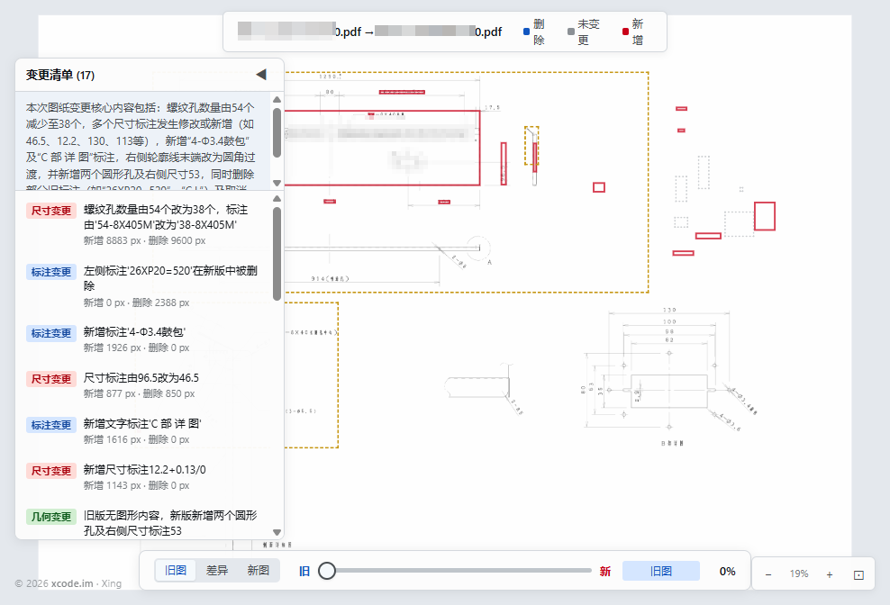

# DrawingContrast — 工程图纸智能差异分析系统

> 基于计算机视觉与多模态 AI 的工程图纸版本差异全自动检测、语义分割与交互可视化平台

---

## 效果演示

<p align="center">
  
</p>

选定两版图纸后一键比对，自动识别变更、无需逐项人工核对：

- **变更清单自动分类** — 尺寸变更 / 标注变更 / 几何变更分组呈现，修改前后数值一目了然（如「54 → 38」「8883 px → 删除」）
- **清单与图纸双向联动** — 点击清单项即可定位到图纸对应区域，红/橙高亮框直接圈出变更位置
- **旧图 / 差异 / 新图三态切换** — 支持滚轮缩放、拖拽平移，细节逐像素可查

---

## 系统概述

**DrawingContrast** 是面向机械工程、建筑设计及工业制造领域的专业级图纸变更智能分析系统。系统采用亚像素级图像配准算法、自适应差异分割引擎，并集成多模态大语言模型进行图纸主体区域智能识别，实现从 PDF 矢量图纸到交互式差异可视化的全链路自动化处理。

本系统突破了传统人工比对效率低、遗漏率高的瓶颈，将工程图纸审图效率提升一个数量级。

---

## 核心技术架构

### 多层渲染管线

```
PDF 矢量解析 → 高精度光栅化 → 自适应线条增强 → 图像配准 → 差异分割 → 图层合成 → GPU 加速渲染
```

### 技术栈

| 层级 | 技术选型 | 说明 |
|------|----------|------|
| 桌面框架 | PyQt6 + QtWebEngine | 原生性能 + 现代 Web 渲染引擎双融合 |
| PDF 解析 | PyMuPDF (fitz) | 高保真矢量到像素转换，支持 2x~4x 超采样 |
| 图像处理 | OpenCV + NumPy | 亚像素配准、形态学运算、色彩空间变换 |
| AI 推理 | 多模态大模型 (Qwen3-VL-32B-Instruct) | 主体区域识别、差异区域语义解读与变更摘要 |
| 前端渲染 | CSS GPU Compositing | 基于 `will-change` 提示的零重绘图层合成 |
| AI 配置 | 本地 BYOK（应用内设置 / 环境变量） | 用户自带 Key，支持任意 OpenAI 兼容多模态服务 |
| 构建交付 | PyInstaller 单文件打包 | 开箱即用，零依赖部署 |

---

## 核心算法

### 1. 自适应图像配准引擎

针对工程图纸的特殊性（大面积留白、稀疏线条分布、标题栏干扰），系统采用：

- **多尺度 ORB 特征提取** — 在不同分辨率层级提取关键点，提升稀疏图纸的匹配鲁棒性
- **RANSAC 异常值过滤** — 剔除标题栏、图框等非主体区域的误匹配点
- **透视/仿射变换自适应选择** — 根据匹配点分布自动决策最优变换模型
- **形态学线条增强预处理** — 椭圆核膨胀运算模拟工业打印渲染效果，消除 PDF 解析与实际视觉的差异

### 2. 语义差异分割

- **双通道差异提取** — 独立生成"新增元素层"与"删除元素层"，支持精确追溯每一处变更
- **距离变换容差** — 计算"到对方图纸最近线条"距离场，线条像素距离超过容差才计为真实差异，亚像素配准残差与渲染抖动不再形成成对红蓝误报
- **噪声自适应阈值** — 基于图纸整体灰度分布动态调整检测灵敏度，避免 JPEG 压缩噪声的误报
- **Alpha 通道 RGBA 输出** — 差异图层以半透明叠加方式呈现，不遮挡原始图纸细节

### 3. AI 主体区域智能识别

集成多模态视觉-语言模型（VLM），实现：

- **图纸语义理解** — 自动区分标题栏、图框边界、BOM 表与主体图形区域
- **智能裁剪建议** — 输出归一化坐标的主体区域边界框，聚焦真正的设计变更区域
- **三级容错机制** — 重试策略 + 多级 JSON 解析 + 兜底默认值，确保生产环境 100% 可用性

---

## 交互可视化引擎

### GPU 加速图层合成

摒弃传统 Canvas 2D 逐帧重绘方案，采用 **CSS Compositing Layer** 架构：

- 4 张独立 `` DOM 元素（旧图、新图、新增差异、删除差异）
- 滑块仅修改各层 `opacity` 属性值
- 浏览器 GPU 合成器自动处理透明度混合，帧率锁定 60fps
- `will-change: opacity` + `requestAnimationFrame` 节流，零主线程阻塞

### Smoothstep 过渡算法

采用 Hermite 三次插值曲线替代线性混合：

```javascript
smoothstep(edge0, edge1, x) = t² × (3 - 2t)
```

实现图纸 A/B 之间丝滑的 S 曲线过渡，差异图层以正弦钟形曲线叠加，中段差异最强、两端自然消退。

---

## 系统特性

| 特性 | 描述 |
|------|------|
| 单文件交付 | PyInstaller `--onefile` 打包，约 180MB 单 EXE，双击即用 |
| 多实例隔离 | 独立 WebEngine Profile + 随机端口，支持无限多开 |
| 启动预加载 | QPainter 渲染的品牌 Splash Screen，毫秒级视觉响应 |
| BYOK 零硬编码 | API Key 由用户自带，DPAPI 加密存于程序目录，不进仓库、不写日志 |
| 优雅降级 | 未配置 Key 时自动切换纯 CV 模式，基础对比功能不受影响 |
| 线条增强 | PDF 转图片时自动加粗/加深细线条，解决细线渲染过淡不易看的问题（设置可关） |
| 标注手动开关 | 差异框选/变更清单可在设置中关闭，也可在结果页工具栏一键隐藏，只看红/蓝差异 |
| 高精度渲染 | 4763×3368px 原始分辨率，2x 超采样无损缩放 |
| 全平台交互 | 鼠标滚轮缩放、拖拽平移、键盘快捷键、触屏手势 |

---

## 快速开始

### 环境要求

- Python ≥ 3.11
- Windows 10/11 (x86_64)

### AI 配置（可选，推荐）

图纸主体区域识别与差异区域语义解读依赖多模态大模型（VLM）API。**本项目不带任何 Key，采用 BYOK（自带 Key）模式**，未配置时自动降级为纯 CV 对比，基础功能不受影响。

**方式一：应用内设置（推荐）**

启动应用后点击顶栏「设置」，填入：

- **API Key** — 任意 OpenAI 兼容服务的密钥（如硅基流动 SiliconFlow）
- **Base URL** — 默认 `https://api.siliconflow.cn/v1`，可改为其他兼容服务或本地 vLLM
- **模型名称** — 需支持图像输入，推荐 `Qwen/Qwen3-VL-32B-Instruct`

可先点「测试连接」验证，保存后 Key 经 **Windows DPAPI 加密**存储在程序同目录的 `config.json`（不会被提交）：仅本机当前 Windows 用户可解密，配置文件被拷到其他机器/用户无法还原。

仓库中提供 [`config.sample.json`](config.sample.json) 作为配置结构样本（不含任何密钥，可直接入库）：可复制为 `config.json` 填入配置后直接使用（明文格式兼容自动加载）。

**分发给其他用户（无感生效）**

「设置」对话框提供两种分发方式，均包含 AI / FTP / 日志全部配置：

- **导出分享码** — 生成 `DC1:` 前缀文本，对方在「设置 → 导入分享码」粘贴即可
- **导出配置文件** — 导出明文 `config.json`，对方放到程序同目录（EXE 旁），下次启动自动生效，无需任何操作

> ⚠️ 两种方式均为明文（含 API Key 与 FTP 密码），请仅通过可信渠道分发。

**方式二：环境变量（适合脚本 / CI）**

```powershell
# PowerShell（当前会话生效）
$env:SILICONFLOW_API_KEY = "sk-xxxxxxxx"
# 可选：
# $env:AI_BASE_URL = "https://api.siliconflow.cn/v1"
# $env:AI_MODEL = "Qwen/Qwen3-VL-32B-Instruct"
```

说明：环境变量优先级高于本地配置文件；Key 仅在进程内存与本地配置文件中使用，不会写入日志。

### 可选功能：FTP 零部件编号下载 / 日志上报

除文件选择模式外，还支持**零部件编号模式**（输入两个零部件编号，自动从 FTP 下载 PDF 后对比）与**日志上报**（使用事件统计）。两者均为可选功能：**不配置即不启用**，代码中不含任何内置服务器地址或凭证；也可通过上文「分发给其他用户」将配置一并下发。

**FTP 服务器的特殊要求**

在「设置 → FTP 设置」中填写主机地址/端口/用户名/密码/基础目录后启用。服务器需满足：

- 支持标准 `ftplib`（程序默认被动模式 PASV）与 `RETR` 命令
- 图纸以 `<零部件编号>.pdf` 命名；支持六种目录组织方式（程序按序自动尝试，命中即下载）：
  1. `<基础目录>/<前缀>/<零部件编号>.pdf`（前缀 = 零部件编号首段，如 `8DM-2-1350-275-00-WH` → `8DM`）
  2. `<前缀>/<零部件编号>.pdf`（无基础目录时的前缀子目录）
  3. `<基础目录>/<零部件编号>/<零部件编号>.pdf`
  4. `<零部件编号>/<零部件编号>.pdf`
  5. `<基础目录>/<零部件编号>.pdf`
  6. `<零部件编号>.pdf`（根目录平铺）
- 程序仅使用 `RETR` 直接下载，**不依赖 NLST/LIST 目录列举**，因此在禁用列举命令的服务器上也可正常工作

**日志上报服务的特殊要求**

在「设置 → 日志上报设置」中填写上报 URL 后启用（如 `http://your-log-service/api/v1/logs`）。服务端需接受 `POST` JSON 请求，字段如下：

```json
{
  "service_name": "drawing-contrast",
  "system": "xAuto",
  "app_version": "0.5.1",
  "level": "info | warning | error",
  "message": "事件描述（通用文案，不含图纸内容）",
  "class_name": "模块名",
  "method_name": "方法名",
  "timestamp": 1754803200,
  "elapsed_ms": 12345,
  "extra": {}
}
```

> 说明：`timestamp` 为 epoch 秒级整数（`int(time.time())`），与 Loki/Grafana 现有标签体系保持一致；`system` 仅在配置了该值时上报。

隐私说明：

- **不采集、不上报任何本地主机信息**（主机名/IP/MAC）、文件路径、图纸内容与 API Key
- 上报失败静默降级，绝不影响主业务流程；未配置上报地址时完全不发送任何请求

### 开发运行

```bash
# 安装依赖（含打包工具等开发依赖）
uv sync --extra dev

# 启动应用（入口命令由 pyproject 注册）
uv run drawing-contrast
```

运行时产物（`config.json`、`app.log`、`web/`）统一写入程序目录：开发时为项目根目录，打包后为 EXE 旁目录。

### 打包发布

```bash
# 生成单文件 EXE
uv run scripts/build_exe.py

# 输出: dist/DrawingContrast.exe
```

---

## 项目结构

```
drawingContrast/
├── src/drawing_contrast/         # 应用包
│   ├── app.py                    # 主程序：PyQt6 GUI + HTTP Server + Splash + 设置对话框
│   ├── ai_config.py              # 配置模块：DPAPI 加密本地持久化 + 环境变量覆盖 + 分享码（BYOK）
│   ├── paths.py                  # 统一路径解析（资源目录 / 程序目录 / web 目录）
│   ├── core/                     # 对比引擎
│   │   ├── generate_diff_layers.py  # 配准 + 差异分割 + AI 识别 + VLM 异步解读
│   │   ├── view_blocks.py        # 视图分块配准（块匹配/位移聚类/碎片救援）
│   │   └── vlm_analyzer.py       # VLM 差异区域解读与变更摘要
│   ├── integrations/             # 可选集成（配置驱动，不配置即不启用）
│   │   ├── ftp_downloader.py     # FTP 零部件编号下载器
│   │   └── logbot.py             # 日志上报 SDK
│   └── resources/                # 随包只读资源
│       ├── app_icon.ico          # 多尺寸应用图标 (16~256px)
│       └── web/index.html        # 交互式差异可视化前端（含变更清单侧栏）
├── scripts/                      # 开发/构建工具
│   ├── build_exe.py              # PyInstaller 打包脚本
│   ├── generate_icon.py          # 应用图标生成器
│   ├── web_server.py             # 独立预览服务器
│   ├── detect_focus.py           # VLM 主体区域识别调试工具
│   └── compare_and_annotate.py   # PDF 差异标注调试工具
├── web/                          # 运行时产物目录（自动生成，不入库）
├── config.sample.json            # 配置结构样本（不含密钥）
├── pyproject.toml                # 项目元数据与依赖声明
└── dist/
    └── DrawingContrast.exe       # 最终交付物
```

---

## 许可与版权

本项目基于 [MIT License](LICENSE) 开源。

© 2026 [xcode.im](https://xcode.im) · Xing

项目地址：[https://github.com/ayumilove/DrawingContrast](https://github.com/ayumilove/DrawingContrast)
